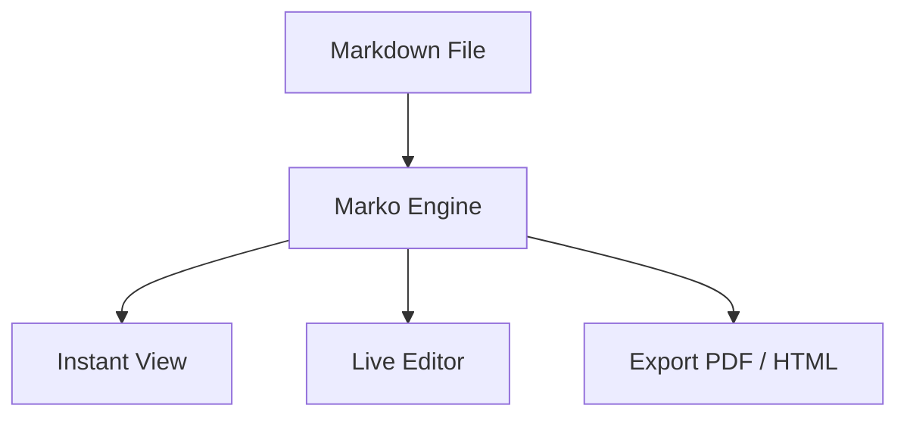

# 🚀 Marko — Markdown (.md) File Viewer & Editor

<div align="center">


<h3>A fast, modern, distraction-free Markdown Viewer and Editor for Windows, macOS, Linux, and Mobile</h3>

[](https://github.com/UXxArunjay/Marko---Markdown-.md-file-Viewer-and-editor/releases)
[](https://github.com/UXxArunjay/Marko---Markdown-.md-file-Viewer-and-editor)
[](https://electronjs.org/)
[](https://capacitorjs.com/)
[](./LICENSE)

<p align="center">
  <a href="#-downloads--installers">Downloads</a> •
  <a href="#-key-features">Key Features</a> •
  <a href="#-mobile-support-android--ios">Mobile App</a> •
  <a href="#-quick-start--development">Development</a> •
  <a href="#-keyboard-shortcuts">Shortcuts</a> •
  <a href="#-license">License</a>
</p>

</div>

---

## 📥 Downloads & Installers

Get Marko for your favorite operating system:

| Platform | Format | Release | Official High-Speed Download |
| :--- | :--- | :---: | :--- |
| **📱 Android Phone** | **APK** (`.apk`) | **v1.3.0** | [⬇️ **Download Marko-1.3.0.apk (Releases)**](https://github.com/UXxArunjay/Marko---Markdown-.md-file-Viewer-and-editor/releases/latest) • [Alternative APK Link](./downloads/Marko-1.2.0.apk?raw=true) |
| **💻 Windows PC** | **Installer** (`.exe`) | **v1.3.0** | [⬇️ **Download Marko-Setup-1.3.0.exe (Releases)**](https://github.com/UXxArunjay/Marko---Markdown-.md-file-Viewer-and-editor/releases/latest) |
| **💻 Windows Portable** | **No Install** (`.zip`) | **v1.3.0** | [⬇️ **Download from All Releases**](https://github.com/UXxArunjay/Marko---Markdown-.md-file-Viewer-and-editor/releases) |

> [!TIP]
> **Recommended:** Always download executable installers and APKs from the official [**GitHub Releases Page**](https://github.com/UXxArunjay/Marko---Markdown-.md-file-Viewer-and-editor/releases/latest) to avoid Git LFS pointer text file issues and get maximum download speeds from GitHub CDN.

---

## 📖 Overview

**Marko** is designed from the ground up for writers, developers, researchers, and students who work with Markdown daily. Unlike traditional text editors that treat preview as a secondary thought, **Marko opens files in View Mode by default**, providing a clean, book-like reading typography experience. 

When you're ready to make edits, seamlessly switch to **Edit Mode** or a side-by-side **Split Mode** with synchronized scrolling.

---

## ✨ Key Features

### 🧘 Single-Tap Zen Fullscreen Mode
* **Distraction-Free Immersion:** Tap anywhere in the reading area to instantly collapse all headers, toolbars, and menus into pure fullscreen mode.
* **1-Tap Restore:** Single tap anywhere again (or press `Esc` / `F11`) to immediately bring back navigation controls.
* **Smart Tap Detection:** Intelligently ignores taps on links, task checkboxes, code copy buttons, and text selections.

### ℹ️ Integrated About Marko & Update Center
* **Built-In Version Details:** View the exact version, release notes, and architecture stack directly inside the app.
* **Live "Check for Updates" Button:** 1-click check against the GitHub Releases API to notify you of newer releases with direct download links.
* **Persistent Changelog:** Complete update history available offline within the application.

### 📈 Reading Progress Bar & Typography Controls
* **Live Scroll Indicator:** Sleek accent progress bar at the very top of the window indicating reading completion from 0% to 100%.
* **Reading Style Customizer:** Seamlessly adjust font family (Modern Sans, Literary Serif, Monospace), font size, and column width.
* **Auto-Save Draft Recovery:** Silent background persistence protects unsaved notes if the browser or system restarts.

### 📱 Full Native Mobile Experience (Android & Mobile Web)
* **Left Slide-Over TOC Drawer:** Off-canvas table of contents with frosted glass backdrop blur and touch-optimized navigation.
* **Thumb-Zone Bottom Navigation:** 5 quick-access tabs (`View`, `Edit`, `Save`, `Claude AI`, `More`).
* **Slide-Up Action Sheet:** 3x3 touch grid for New Doc, File Open, Find, Outline, PDF Export, and Themes.
* **Keyboard-Aware Touch Toolbar:** Single-row horizontally scrollable Markdown formatting bar above the mobile keyboard.
* **Safe-Area Insets & 100dvh:** Seamless integration on bezel-less screens and notch devices.

### 🌊 Sleek Universal Theme-Matching Scrollbars
* Custom slim pill scrollbars that automatically adapt color, opacity, and hover states to the active theme (**Dark**, **Light**, or **Warm Sepia**).
* Zero jarring default browser grey scrollbars; completely unified visual design across all operating systems.

### 🤖 Built-In Claude AI Assistant
* **Direct Anthropic Integration:** Chat with Claude 3.7 Sonnet, Claude 3.5 Sonnet, and Claude 3.5 Haiku.
* **Extended Thinking (Long Think):** Toggle deep multi-step reasoning for complex research.
* **Document Context Awareness:** Claude reads your open Markdown document and current selection.
* **Visual Diff Review:** Review AI-proposed document changes with interactive line diffs before applying.

### 👁️ Reading-First Philosophy (Default View Mode)
Every `.md` file opens instantly in a distraction-free, beautifully formatted reading view. Clean line lengths, elegant headings, and balanced line-height ensure maximum legibility.

### ✏️ Flexible Multi-Mode Workflow
- **View Mode (`Default`)**: Clean reader view with rendered tables, diagrams, and math.
- **Edit Mode (`Ctrl + E`)**: Fast Markdown editor with markdown-aware shortcut toolbar.
- **Split Mode**: Side-by-side editing with instant live preview.

### 🧮 KaTeX Mathematical Typesetting
Full zero-latency rendering of scientific notes and formulas:
- Inline equations: `$E = mc^2$`
- Block equations:
  ```latex
  \int_{-\infty}^{\infty} e^{-x^2} dx = \sqrt{\pi}
  ```

### 📊 Native Mermaid Diagrams
Create architecture charts, flowcharts, sequence diagrams, and class diagrams directly inside your markdown:


### 🎨 Syntax Highlighting & Code Blocks
- Automatic syntax highlighting for 100+ languages with **Highlight.js**.
- Code language badges and a convenient **1-Click Copy** button.

### 💡 GitHub-Flavored Markdown (GFM) & Callouts
Supports all modern GitHub callouts with distinct color-coded styling:
> [!NOTE]
> Helpful background notes or details.

> [!TIP]
> Pro-tips and workflow optimizations.

> [!IMPORTANT]
> Must-know crucial instructions.

> [!WARNING]
> Warnings and breaking changes.

> [!CAUTION]
> High-risk actions.

### 📑 Dynamic Table of Contents (Outline)
- Real-time scroll-spy table of contents tracking your reading progress.
- Quick navigation through deep heading hierarchies (`H1` to `H6`).

### 🔍 In-Document Search & Highlight
Find terms instantly with `Ctrl + F`. Marko highlights matches directly across the rendered view and live editor with match counter and navigation controls.

### 📤 Multi-Format Export
- **Print to PDF**: Clean print stylesheet tailored for reports and documentation.
- **Standalone HTML**: Self-contained HTML file with embedded styling.
- **Raw Markdown**: Formatted `.md` file export.
- **Copy HTML / Markdown**: Instant clipboard copying.

### 🌓 Customizable Themes
Switch between curated themes in 1 click:
- 🌙 **Dark (Default)**: Eye-friendly deep obsidian aesthetic with matching translucent scrollbars.
- ☀️ **Light Mode**: High-contrast, clean day reading with subtle slate scrollbars.
- 📜 **Warm Sepia**: Paperback novel style for long-form reading with warm woodtone scrollbars.

### 💾 Native File System & File Associations
- Open and save directly to your local drive with the **File System Access API**.
- Double-clicking `.md` and `.markdown` files on Windows automatically opens them in Marko.
- Drag & Drop any `.md` file directly into the application window.

---

## 🛠️ Quick Start & Development

### 1. Prerequisites
- [Node.js](https://nodejs.org/) (v18 or higher)
- npm or yarn

### 2. Clone the Repository
```bash
git clone https://github.com/UXxArunjay/Marko---Markdown-.md-file-Viewer-and-editor.git
cd Marko---Markdown-.md-file-Viewer-and-editor
```

### 3. Install Dependencies
```bash
npm install
```

### 4. Run Development Server
```bash
npm run dev
```
Open [http://localhost:5173](http://localhost:5173) in your browser.

### 5. Run as Electron Desktop App
```bash
npm run electron:start
```

### 6. Build the Windows Installer (`.exe`)
```bash
npm run dist:win
```
The compiled installer will be placed in the `release/` folder as `Marko Setup 1.2.0.exe`.

---

## 📱 Mobile Support (Android & iOS)

Marko is pre-configured with **Capacitor 8** for native mobile deployment.

### Android:
```bash
# Option A: One-step build & generate debug APK
npm run build:android

# Option B: Manual step-by-step
npm run build
npm run cap:sync
npm run cap:open:android
```
The output debug APK is generated at:
`android/app/build/outputs/apk/debug/app-debug.apk` (and copied to `downloads/Marko-1.2.0.apk`).

### iOS (macOS required):
```bash
npm run build
npm run cap:add:ios
npm run cap:open:ios
```

For complete mobile configuration details, refer to [`CAPACITOR_MOBILE_GUIDE.md`](./CAPACITOR_MOBILE_GUIDE.md).

---

## ⌨️ Keyboard Shortcuts

| Shortcut | Action |
| :--- | :--- |
| **`Ctrl / Cmd + O`** | Open local `.md` file |
| **`Ctrl / Cmd + S`** | Save document directly to disk |
| **`Ctrl / Cmd + N`** | Create new document |
| **`Ctrl / Cmd + E`** | Switch View Mode ↔ Edit Mode |
| **`Ctrl / Cmd + F`** | Find in document |
| **`Ctrl / Cmd + B`** | Toggle Table of Contents sidebar |
| **`Ctrl / Cmd + P`** | Export to PDF (Print preview) |
| **`Tab / Shift + Tab`** | Indent / Unindent inside editor |
| **`Escape`** | Close open modals or search bar |

---

## 🏗️ Project Architecture

```
Marko/
├── app-icons/               # Original Android & iOS asset packages
│   ├── android/             # 48x48 to 512x512 icons
│   └── ios/                 # 40x40 to 1024x1024 icons
├── build/                   # Electron builder packaging icons (.ico & .png)
├── electron/                # Native Electron integration
│   ├── main.cjs             # Desktop window, file associations, single instance lock
│   └── preload.cjs          # Secure IPC communication bridge
├── public/                  # Static assets & PWA manifest
│   ├── favicon.ico          # Multi-resolution application icon
│   ├── icon-192.png         # PWA icon 192x192
│   ├── icon-512.png         # PWA icon 512x512
│   └── manifest.webmanifest # Web App Manifest configuration
├── src/                     # Core application source
│   ├── main.js              # Coordinator and lifecycle manager
│   ├── markdown-parser.js   # Marked + KaTeX + Mermaid + Highlight.js engine
│   ├── editor.js            # Markdown editor toolbar and keyboard helpers
│   ├── file-manager.js      # File System Access API & cross-platform fallbacks
│   ├── export-manager.js    # PDF, standalone HTML, and clipboard exporter
│   ├── outline.js           # Real-time Table of Contents & scroll-spy
│   ├── search.js            # In-document search & highlight engine
│   ├── sample-docs.js       # Preloaded showcase documents and templates
│   └── style.css            # Responsive design system & themes
├── capacitor.config.json    # Capacitor mobile bundle configuration
├── index.html               # Main application shell
├── package.json             # Scripts, dependencies, and electron-builder config
└── vite.config.js           # Vite bundle configuration
```

---

## 🤝 Community & Contributing

We welcome contributions from everyone! To keep our community healthy and welcoming, please review our public repository guidelines:

- **[Contributing Guide](./CONTRIBUTING.md)**: Workflow, issue creation, branching, testing, and PR guidelines.
- **[Code of Conduct](./CODE_OF_CONDUCT.md)**: Community standards and enforcement based on Contributor Covenant v2.1.
- **[Security Policy](./SECURITY.md)**: Responsible disclosure process and reporting procedure.

---

## 📄 License

This project is open-source and licensed under the [MIT License](./LICENSE).

---

## 👤 Author & Maintainer

Developed with ❤️ by **[UXxArunjay](https://github.com/UXxArunjay)**

*Contributions, issues, and feature requests are welcome! Feel free to check the [issues page](https://github.com/UXxArunjay/Marko---Markdown-.md-file-Viewer-and-editor/issues).*
