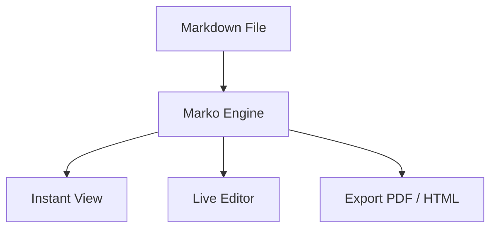

# 🚀 Marko — Markdown (.md) File Viewer & Editor

<div align="center">


<h3>A fast, modern, distraction-free Markdown Viewer and Editor for Windows, macOS, Linux, and Mobile</h3>

[](https://github.com/UXxArunjay/Marko---Markdown-.md-file-Viewer-and-editor/releases)
[](https://github.com/UXxArunjay/Marko---Markdown-.md-file-Viewer-and-editor)
[](https://electronjs.org/)
[](https://vitejs.dev/)
[](./LICENSE)

<p align="center">
  <a href="#-key-features">Key Features</a> •
  <a href="#-download--windows-installer">Download & Install</a> •
  <a href="#-quick-start--development">Development</a> •
  <a href="#-keyboard-shortcuts">Shortcuts</a> •
  <a href="#-mobile-support">Mobile</a> •
  <a href="#-license">License</a>
</p>

</div>

---

## 📖 Overview

**Marko** is designed from the ground up for writers, developers, researchers, and students who work with Markdown daily. Unlike traditional text editors that treat preview as a secondary thought, **Marko opens files in View Mode by default**, providing a clean, book-like reading typography experience. 

When you're ready to make edits, seamlessly switch to **Edit Mode** or a side-by-side **Split Mode** with synchronized scrolling.

---

## ✨ Key Features

### 👁️ Reading-First Philosophy (Default View Mode)
Every `.md` file opens instantly in a distraction-free, beautifully formatted reading view. Clean line lengths, elegant headings, and balanced line-height ensure maximum legibility.

### ✏️ Flexible Multi-Mode Workflow
- **View Mode (`Default`)**: Clean reader view with rendered tables, diagrams, and math.
- **Edit Mode (`Ctrl + E`)**: Fast Markdown editor with markdown-aware shortcut toolbar.
- **Split Mode**: Side-by-side editing with instant live preview.

### 🧮 KaTeX Mathematical Typesetting
Full zero-latency rendering of scientific notes and formulas:
- Inline equations: `$E = mc^2$`
- Block equations:
  ```latex
  \int_{-\infty}^{\infty} e^{-x^2} dx = \sqrt{\pi}
  ```

### 📊 Native Mermaid Diagrams
Create architecture charts, flowcharts, sequence diagrams, and class diagrams directly inside your markdown:


### 🎨 Syntax Highlighting & Code Blocks
- Automatic syntax highlighting for 100+ languages with **Highlight.js**.
- Code language badges and a convenient **1-Click Copy** button.

### 💡 GitHub-Flavored Markdown (GFM) & Callouts
Supports all modern GitHub callouts with distinct color-coded styling:
> [!NOTE]
> Helpful background notes or details.

> [!TIP]
> Pro-tips and workflow optimizations.

> [!IMPORTANT]
> Must-know crucial instructions.

> [!WARNING]
> Warnings and breaking changes.

> [!CAUTION]
> High-risk actions.

### 📑 Dynamic Table of Contents (Outline)
- Real-time scroll-spy table of contents tracking your reading progress.
- Quick navigation through deep heading hierarchies (`H1` to `H6`).

### 🔍 In-Document Search & Highlight
Find terms instantly with `Ctrl + F`. Marko highlights matches directly across the rendered view and live editor with match counter and navigation controls.

### 📤 Multi-Format Export
- **Print to PDF**: Clean print stylesheet tailored for reports and documentation.
- **Standalone HTML**: Self-contained HTML file with embedded styling.
- **Raw Markdown**: Formatted `.md` file export.
- **Copy HTML / Markdown**: Instant clipboard copying.

### 🌓 Customizable Themes
Switch between curated themes in 1 click:
- 🌙 **Dark (Default)**: Eye-friendly deep obsidian aesthetic.
- ☀️ **Light Mode**: High-contrast, clean day reading.
- 📜 **Warm Sepia**: Paperback novel style for long-form reading.

### 💾 Native File System & File Associations
- Open and save directly to your local drive with the **File System Access API**.
- Double-clicking `.md` and `.markdown` files on Windows automatically opens them in Marko.
- Drag & Drop any `.md` file directly into the application window.

---

## 💻 Download & Windows Installer

### Official Windows Release (`v1.1.0`)
Download the latest Windows installer from the [Releases](https://github.com/UXxArunjay/Marko---Markdown-.md-file-Viewer-and-editor/releases) section:

- **Installer Wizard**: `Marko Setup 1.1.0.exe` (NSIS setup wizard with Desktop & Start Menu shortcuts, `.md` file associations).
- **Portable Version**: `release/win-unpacked/Marko.exe` (Runs directly without installation).

---

## 🛠️ Quick Start & Development

### 1. Prerequisites
- [Node.js](https://nodejs.org/) (v18 or higher)
- npm or yarn

### 2. Clone the Repository
```bash
git clone https://github.com/UXxArunjay/Marko---Markdown-.md-file-Viewer-and-editor.git
cd Marko---Markdown-.md-file-Viewer-and-editor
```

### 3. Install Dependencies
```bash
npm install
```

### 4. Run Development Server
```bash
npm run dev
```
Open [http://localhost:5173](http://localhost:5173) in your browser.

### 5. Run as Electron Desktop App
```bash
npm run electron:start
```

### 6. Build the Windows Installer (`.exe`)
```bash
npm run dist:win
```
The compiled installer will be placed in the `release/` folder as `Marko Setup 1.1.0.exe`.

---

## 📱 Mobile Support (Android & iOS)

Marko is pre-configured with **Capacitor 8** for native mobile deployment.

### Android:
```bash
# 1. Build web distribution
npm run build

# 2. Add Android platform (one-time setup)
npm run cap:add:android

# 3. Open in Android Studio & generate APK / Bundle
npm run cap:open:android
```

### iOS (macOS required):
```bash
npm run build
npm run cap:add:ios
npm run cap:open:ios
```

For complete mobile configuration details, refer to [`CAPACITOR_MOBILE_GUIDE.md`](./CAPACITOR_MOBILE_GUIDE.md).

---

## ⌨️ Keyboard Shortcuts

| Shortcut | Action |
| :--- | :--- |
| **`Ctrl / Cmd + O`** | Open local `.md` file |
| **`Ctrl / Cmd + S`** | Save document directly to disk |
| **`Ctrl / Cmd + N`** | Create new document |
| **`Ctrl / Cmd + E`** | Switch View Mode ↔ Edit Mode |
| **`Ctrl / Cmd + F`** | Find in document |
| **`Ctrl / Cmd + B`** | Toggle Table of Contents sidebar |
| **`Ctrl / Cmd + P`** | Export to PDF (Print preview) |
| **`Tab / Shift + Tab`** | Indent / Unindent inside editor |
| **`Escape`** | Close open modals or search bar |

---

## 🏗️ Project Architecture

```
Marko/
├── app-icons/               # Original Android & iOS asset packages
│   ├── android/             # 48x48 to 512x512 icons
│   └── ios/                 # 40x40 to 1024x1024 icons
├── build/                   # Electron builder packaging icons (.ico & .png)
├── electron/                # Native Electron integration
│   ├── main.cjs             # Desktop window, file associations, single instance lock
│   └── preload.cjs          # Secure IPC communication bridge
├── public/                  # Static assets & PWA manifest
│   ├── favicon.ico          # Multi-resolution application icon
│   ├── icon-192.png         # PWA icon 192x192
│   ├── icon-512.png         # PWA icon 512x512
│   └── manifest.webmanifest # Web App Manifest configuration
├── src/                     # Core application source
│   ├── main.js              # Coordinator and lifecycle manager
│   ├── markdown-parser.js   # Marked + KaTeX + Mermaid + Highlight.js engine
│   ├── editor.js            # Markdown editor toolbar and keyboard helpers
│   ├── file-manager.js      # File System Access API & cross-platform fallbacks
│   ├── export-manager.js    # PDF, standalone HTML, and clipboard exporter
│   ├── outline.js           # Real-time Table of Contents & scroll-spy
│   ├── search.js            # In-document search & highlight engine
│   ├── sample-docs.js       # Preloaded showcase documents and templates
│   └── style.css            # Responsive design system & themes
├── capacitor.config.json    # Capacitor mobile bundle configuration
├── index.html               # Main application shell
├── package.json             # Scripts, dependencies, and electron-builder config
└── vite.config.js           # Vite bundle configuration
```

---

## 📄 License

This project is licensed under the [MIT License](./LICENSE).

---

## 👤 Author

Developed with ❤️ by **[UXxArunjay](https://github.com/UXxArunjay)**

*Contributions, issues, and feature requests are welcome! Feel free to check the [issues page](https://github.com/UXxArunjay/Marko---Markdown-.md-file-Viewer-and-editor/issues).*
