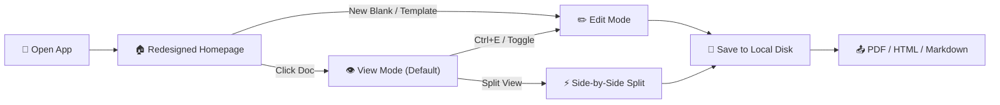
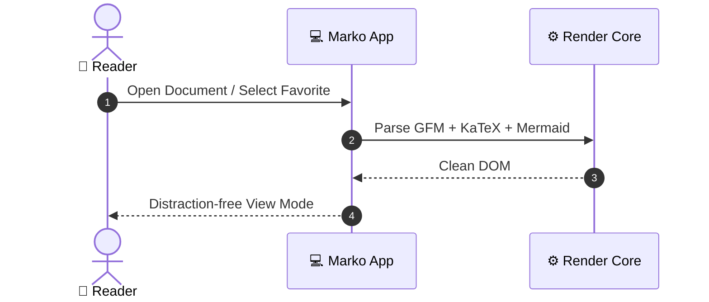

# 📖 Marko User Manual & Reference Guide

Welcome to the official User Manual for **Marko** — the high-performance, distraction-free cross-platform Markdown Viewer and Editor for Windows, macOS, Linux, and Mobile.

---

## 📑 Table of Contents
1. [Overview & Core Philosophy](#overview--core-philosophy)
2. [Homepage & File Management](#homepage--file-management)
   - [Recently Opened Files](#recently-opened-files)
   - [Most Opened Files](#most-opened-files)
   - [Favorites & Bookmarks](#favorites--bookmarks)
3. [Reading Experience (View Mode)](#reading-experience-view-mode)
   - [Reading Typography Settings](#reading-typography-settings)
   - [Zen Fullscreen Mode](#zen-fullscreen-mode)
   - [Table of Contents & Dynamic Outline](#table-of-contents--dynamic-outline)
4. [Editing & Live Split Mode](#editing--live-split-mode)
   - [Formatting Toolbar](#formatting-toolbar)
   - [Auto-Save & Draft Recovery](#auto-save--draft-recovery)
5. [Touchscreen & Mobile Gestures](#touchscreen--mobile-gestures)
   - [Edge Swipe Gestures](#edge-swipe-gestures)
   - [Pinch-to-Zoom Font Scaling](#pinch-to-zoom-font-scaling)
   - [Double-Tap Interactions](#double-tap-interactions)
   - [Mobile Bottom Navigation & Action Sheets](#mobile-bottom-navigation--action-sheets)
6. [Supported Markdown Features](#supported-markdown-features)
   - [GitHub Flavored Alerts](#github-flavored-alerts)
   - [KaTeX Mathematical Equations](#katex-mathematical-equations)
   - [Interactive Mermaid Diagrams](#interactive-mermaid-diagrams)
   - [Code Syntax Highlighting](#code-syntax-highlighting)
   - [GFM Task Checklists & Tables](#gfm-task-checklists--tables)
7. [Exporting & Sharing](#exporting--sharing)
8. [Claude AI Assistant](#claude-ai-assistant)
9. [Keyboard Shortcuts Reference](#keyboard-shortcuts-reference)
10. [Troubleshooting & FAQs](#troubleshooting--faqs)

---

## Overview & Core Philosophy

Marko is designed around a **Reading-First** philosophy. Most Markdown applications force you into an editor pane with noisy syntax markers. Marko defaults to **View Mode**, presenting clean typography, live diagrams, styled math formulas, and interactive task checklists immediately.



> [!NOTE]
> View Mode is always active by default when opening any document, preserving your focus while reading.

---

## Homepage & File Management

The Marko Homepage provides quick access to your document library, recent work, and starter templates.

### Recently Opened Files
- Tracks files opened in Marko, displaying relative time (*e.g., "5m ago", "Yesterday"*), file preview, and document size.
- Click any recent file to resume reading immediately.
- Remove unwanted items from your history with the remove button (✕).

### Most Opened Files
- Automatically counts how frequently you open each file.
- Ranks your most frequently referenced notes, documentation, and specs at the top with open count badges (*e.g., "14 opens"*).

### Favorites & Bookmarks
- Star (⭐) any document to pin it to your **Favorites** collection.
- Star documents directly from the Homepage cards, the header file pill, or the sidebar.
- Access your essential files instantly without digging through file folders.

---

## Reading Experience (View Mode)

### Reading Typography Settings
Customize reading ergonomics by clicking the Typography icon (Aa) in the header or through the Shortcuts Hub:
- **Font Families**: Modern Sans (*Inter*), Literary Serif (*Georgia*), or Code Mono (*JetBrains Mono*).
- **Font Sizes**: Compact (14px), Standard (16px), Comfortable (18px), or Large (20px). On touchscreen devices, you can also pinch-to-zoom!
- **Column Widths**: Narrow (680px), Balanced (860px), Wide (1080px), or Full Width (100%).
- **Color Themes**: Dark (Default), Light, and warm Sepia Reader.

### Zen Fullscreen Mode
- Enter distraction-free fullscreen reading by pressing `F11` or tapping anywhere on the prose (in single-tap Zen mode).
- All chrome, headers, and toolbars are hidden.
- A floating HUD pill at the top allows you to restore normal view with one click, or simply press `Esc`.

### Table of Contents & Dynamic Outline
- Toggle the Table of Contents sidebar using `Ctrl+B` (or the hamburger button `☰`).
- Tracks your active scroll position automatically and allows jumping straight to any section.

---

## Editing & Live Split Mode

### Formatting Toolbar
Switch to **Edit Mode** (`Ctrl+E`) or **Split Mode** for side-by-side editing:
- **Headers & Emphasis**: Bold (`Ctrl+B` in editor), Italic, Strikethrough, Heading 2.
- **Lists**: Bullet lists, numbered lists, and interactive task checklists.
- **Blocks**: Blockquotes, code blocks, tables, horizontal rules.
- **Special Inserts**: One-click insertion of KaTeX math blocks and Mermaid chart templates.

### Auto-Save & Draft Recovery
- Marko automatically caches in-progress drafts every 3 seconds to local browser storage.
- If your device restarts or browser window closes unexpectedly, your latest edits are safeguarded.

---

## Touchscreen & Mobile Gestures

Marko is fully touch-optimized for Windows 2-in-1 laptops, Microsoft Surface, iPad, Android tablets, and smartphones.

| Touch Gesture | Location | Action |
| :--- | :--- | :--- |
| **Edge Swipe Right** | Left screen edge | Opens the Table of Contents & Navigation sidebar |
| **Swipe Left** | Active sidebar | Smoothly closes the sidebar |
| **Two-Finger Pinch** | Document reading pane | Smoothly zooms and adjusts reading font size |
| **Double-Tap** | Reading pane | Toggles Zen Fullscreen mode on / off |
| **Swipe Down** | Mobile Action Sheet / Modals | Dismisses the bottom sheet or modal |
| **Single Tap** | Reading text | Toggles Zen Fullscreen (when enabled in settings) |

---

## Supported Markdown Features

### GitHub Flavored Alerts

> [!NOTE]
> Highlights useful information, context, or tips for users.

> [!TIP]
> Helpful recommendations to optimize your workflow.

> [!IMPORTANT]
> Crucial information required for completing an operation.

> [!WARNING]
> Critical warnings to prevent data loss or unintended outcomes.

> [!CAUTION]
> High-risk alerts warning of hazardous actions.

### KaTeX Mathematical Equations
Write inline math equations such as $E = mc^2$ or $\nabla \times \mathbf{B} = \frac{1}{c} \frac{\partial \mathbf{E}}{\partial t}$, or full centered display formulas:

$$
\int_{-\infty}^{\infty} e^{-x^2} \, dx = \sqrt{\pi}
$$

The famous Gaussian normal distribution:

$$
f(x) = \frac{1}{\sigma \sqrt{2\pi}} \exp\left( -\frac{(x - \mu)^2}{2\sigma^2} \right)
$$

### Interactive Mermaid Diagrams
Marko natively compiles Mermaid diagrams on the fly:



### Code Syntax Highlighting
Marko includes syntax highlighting with line numbering and instant copy buttons:

```python
def fibonacci(n: int) -> list[int]:
    """Generates Fibonacci sequence up to n terms."""
    if n <= 0:
        return []
    seq = [0, 1]
    while len(seq) < n:
        seq.append(seq[-1] + seq[-2])
    return seq[:n]

if __name__ == "__main__":
    print(fibonacci(8))  # [0, 1, 1, 2, 3, 5, 8, 13]
```

### GFM Task Checklists & Tables
Interactive task checkboxes can be checked or unchecked directly in View Mode:

- [x] Responsive layout on desktop, tablet, and mobile
- [x] Smooth scrolling sidebar with zero clipping
- [x] Touchscreen gestures (pinch-zoom, edge swipe, double tap)
- [x] Favorite, Recent, and Most Opened file management
- [x] Standalone User Manual accessible on demand

---

## Exporting & Sharing

Access export options via the **Export** menu in the header or the mobile action sheet:
- **Export to PDF**: Clean print-optimized document view with pagination.
- **Export as HTML**: Self-contained, styled HTML file ready for publishing or email sharing.
- **Export as Markdown**: Download raw `.md` file to disk.
- **Copy Rendered HTML**: Copies formatted HTML to your clipboard for pasting into Google Docs or Word.
- **Copy Raw Markdown**: Copies clean Markdown source.

---

## Claude AI Assistant

Click the **Claude AI** button (`Ctrl+J`) in the top navigation bar to open the intelligent sidebar assistant:
- **Summarize & Analyze**: Generate concise executive summaries or extract key points.
- **Refine & Polish**: Improve tone, fix grammar, or translate text.
- **Extend & Outline**: Brainstorm sections, generate Mermaid diagrams, or format tables.
- **1-Click Apply**: Replace current text or insert generated snippets directly into your document.

---

## Keyboard Shortcuts Reference

| Shortcut | Description |
| :--- | :--- |
| `Ctrl / Cmd + O` | Open `.md` file from disk |
| `Ctrl / Cmd + S` | Save active document |
| `Ctrl / Cmd + N` | Create new document (Template Chooser) |
| `Ctrl / Cmd + E` | Switch between View Mode and Edit Mode |
| `Ctrl / Cmd + B` | Toggle Table of Contents sidebar |
| `Ctrl / Cmd + F` | Find in document |
| `Ctrl / Cmd + J` | Toggle Claude AI Assistant panel |
| `Ctrl / Cmd + P` | Export / Print to PDF |
| `F11` | Toggle Fullscreen / Zen View |
| `F1` | Open About, Updates & Shortcuts Hub |
| `Esc` | Exit Zen Fullscreen / Close modals and search |

---

## Troubleshooting & FAQs

**Q: Where are my recent and favorite files stored?**  
A: File metadata and cached previews are stored locally in your device's secure browser / application storage. No documents are uploaded to third-party servers.

**Q: How do I set Marko as the default viewer on Windows?**  
A: Open the About Marko dialog (`F1` or click the Marko logo), select **Set as Default**, and Windows will assign `.md` and `.markdown` files to open directly in Marko.

**Q: Can I use Marko offline?**  
A: Yes! Marko works completely offline. Math typesetting, Mermaid rendering, code syntax highlighting, and file editing all function with zero internet connection.

